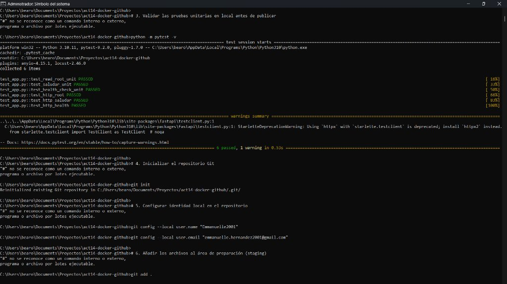
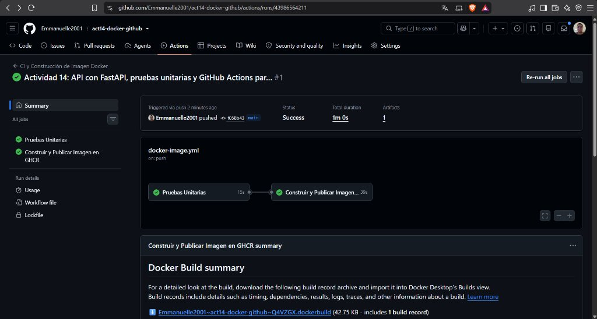
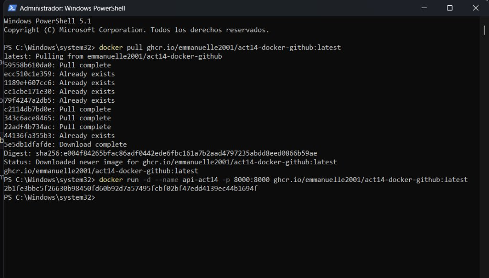
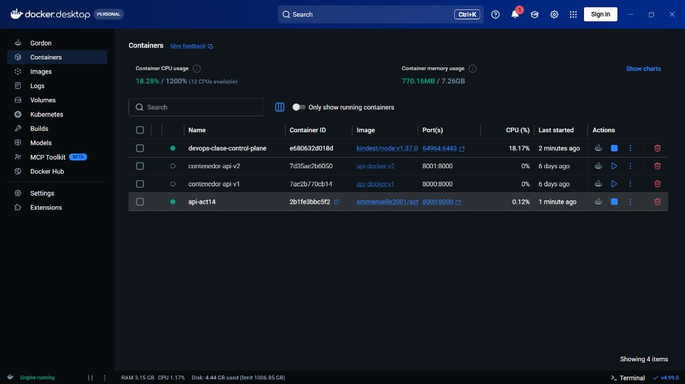
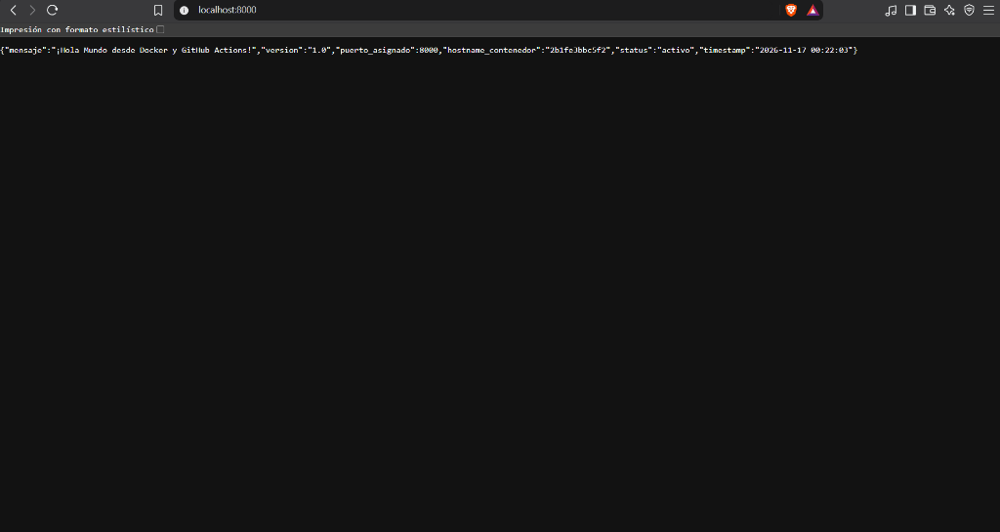

# ACTIVIDAD 14: DOCKER IMAGEN EN GITHUB (GHCR)

**Asignatura:** Gestión del Proceso de Desarrollo de Software  
**Alumno:** Emmanuelle Hernández Oropeza  
**Fecha:** 17 de noviembre de 2026  

---

## 1. Introducción y Objetivos
El objetivo principal de esta práctica es implementar un ciclo completo de Integración Continua y Despliegue Continuo (CI/CD) utilizando GitHub Actions y GitHub Container Registry (GHCR) para compilar, probar, publicar y desplegar una imagen de contenedor Docker a partir de una API desarrollada en Python con FastAPI.

A través de esta actividad se logra:
- Modularizar dependencias entre entornos de desarrollo/pruebas y producción.
- Automatizar la ejecución de pruebas unitarias mediante `pytest`.
- Diseñar pipelines declarativos en YAML organizados en jobs dependientes.
- Publicar artefactos OCI (imágenes de contenedor) de forma segura en un registro centralizado.
- Descargar (`docker pull`) y ejecutar (`docker run`) imágenes publicadas en un entorno local.

---

## 2. Solución a los Desafíos Propuestos

### 2.1. Ordenamiento Lógico de los Comandos en Consola
Los comandos proporcionados inicialmente se encontraban desordenados. La secuencia técnica correcta se divide en dos fases:

```bash
# ==========================================
# FASE 1: PREPARACIÓN LOCAL Y REPOSITORIO GIT
# ==========================================

# 1. Instalar dependencias de producción de la API
python -m pip install -r requirements.txt

# 2. Instalar dependencias adicionales de desarrollo y pruebas (pytest, httpx)
python -m pip install -r requirements-dev.txt

# 3. Ejecutar y validar que las pruebas unitarias pasen exitosamente
python -m pytest -v

# 4. Inicializar el repositorio Git local
git init

# 5. Configurar la identidad del usuario para el repositorio
git config --local user.name "Emmanuelle2001"
git config --local user.email "emmanuelle.hernandez2001@gmail.com"

# 6. Agregar todos los archivos al área de preparación (staging)
git add .
git commit -m "feat: implementacion inicial de API, tests y workflow CI/CD"
git branch -M main
git remote add origin https://github.com/Emmanuelle2001/act14-docker-github.git
git push -u origin main

# ==========================================
# FASE 2: DESCARGA Y EJECUCIÓN CON DOCKER
# ==========================================

# 7. Descargar la imagen construida por GitHub Actions desde GitHub Container Registry
docker pull ghcr.io/emmanuelle2001/act14-docker-github:latest

# 8. Ejecutar el contenedor mapeando el puerto del host al contenedor en segundo plano
docker run -d --name api-act14 -p 8000:8000 ghcr.io/emmanuelle2001/act14-docker-github:latest
```

---

### 2.2. Corrección y Estructuración del Workflow `.yml`
En el material de la actividad, los pasos del archivo YAML se encontraban mezclados en una lista única y con discrepancias intencionales. 

#### Errores identificados y corregidos:
1. **Falta de división en Jobs:** Un pipeline profesional debe separar la fase de **pruebas (`test`)** de la fase de **construcción y empaquetado (`imagen`)**. Si las pruebas fallan, la imagen no debe compilarse ni publicarse.
2. **Dependencias de prueba incorrectas:** El step de instalación de dependencias en el job de pruebas intentaba instalar `requirements.txt`. Al separar dependencias, `pytest` no estaría disponible; se corrigió a `requirements-dev.txt`.
3. **Falta de permisos de publicación:** Por defecto, los tokens en GitHub Actions (`GITHUB_TOKEN`) tienen permisos restringidos de solo lectura. Para publicar paquetes en GHCR se requirió declarar explícitamente `permissions: packages: write`.
4. **Desorden de dependencias de pasos:** El paso para formatear el nombre de la imagen a minúsculas (`IMAGE_NAME="${GITHUB_REPOSITORY,,}"`) y la configuración de Buildx debían ubicarse estrictamente antes del paso `docker/build-push-action`.

#### Archivo `.github/workflows/docker-image.yml` Final:
```yaml
name: CI y Construcción de Imagen Docker

on:
  push:
    branches: [ "main", "master" ]
  pull_request:
    branches: [ "main", "master" ]
  workflow_dispatch:

jobs:
  # Job 1: Pruebas unitarias automatizadas
  test:
    name: Pruebas Unitarias
    runs-on: ubuntu-latest
    steps:
      - name: Descargar repositorio
        uses: actions/checkout@v4

      - name: Configurar Python
        uses: actions/setup-python@v5
        with:
          python-version: "3.12"

      - name: Instalar dependencias
        run: python -m pip install -r requirements-dev.txt

      - name: Ejecutar pruebas
        run: python -m pytest -v

  # Job 2: Construcción y publicación en GHCR
  imagen:
    name: Construir y Publicar Imagen en GHCR
    needs: test
    runs-on: ubuntu-latest
    permissions:
      contents: read
      packages: write
    steps:
      - name: Descargar repositorio
        uses: actions/checkout@v4

      - name: Preparar nombre de imagen
        id: image
        shell: bash
        run: |
          IMAGE_NAME="${GITHUB_REPOSITORY,,}"
          echo "name=ghcr.io/${IMAGE_NAME}" >> "$GITHUB_OUTPUT"

      - name: Configurar Docker Buildx
        uses: docker/setup-buildx-action@v3

      - name: Iniciar sesión en GHCR
        if: github.event_name != 'pull_request'
        uses: docker/login-action@v3
        with:
          registry: ghcr.io
          username: ${{ github.actor }}
          password: ${{ secrets.GITHUB_TOKEN }}

      - name: Construir y publicar imagen
        uses: docker/build-push-action@v6
        with:
          context: .
          push: ${{ github.event_name != 'pull_request' }}
          tags: ${{ steps.image.outputs.name }}:latest
```

---

## 3. Implementación de la Aplicación

### 3.1. Código Fuente de la API (`app.py`)
```python
from fastapi import FastAPI
import socket
import datetime

app = FastAPI(
    title="API Docker - Actividad 14",
    description="API para generación de imagen en GitHub Container Registry (GHCR) y ejecución en Docker",
    version="1.0.0"
)

@app.get("/")
def read_root():
    return {
        "mensaje": "¡Hola Mundo desde Docker y GitHub Actions!",
        "version": "1.0",
        "puerto_asignado": 8000,
        "hostname_contenedor": socket.gethostname(),
        "status": "activo",
        "timestamp": datetime.datetime.now().strftime("%Y-%m-%d %H:%M:%S")
    }

@app.get("/saludo/{nombre}")
def saludar(nombre: str):
    return {
        "saludo": f"Hola, {nombre}. Bienvenido a la API contenerizada.",
        "version": "1.0"
    }

@app.get("/health")
def health_check():
    return {
        "status": "ok",
        "servicio": "api-docker-ghcr"
    }

if __name__ == "__main__":
    import uvicorn
    uvicorn.run(app, host="0.0.0.0", port=8000)
```

### 3.2. Pruebas Unitarias (`test_app.py`)
```python
import pytest
from app import app, read_root, saludar, health_check

def test_read_root_unit():
    data = read_root()
    assert isinstance(data, dict)
    assert data["status"] == "activo"
    assert data["version"] == "1.0"
    assert data["puerto_asignado"] == 8000
    assert "hostname_contenedor" in data

def test_saludar_unit():
    data = saludar("Emmanuelle")
    assert isinstance(data, dict)
    assert data["version"] == "1.0"
    assert data["saludo"] == "Hola, Emmanuelle. Bienvenido a la API contenerizada."

def test_health_check_unit():
    data = health_check()
    assert isinstance(data, dict)
    assert data["status"] == "ok"
    assert data["servicio"] == "api-docker-ghcr"
```

### 3.3. Separación de Requerimientos
- **`requirements.txt` (Producción / Imagen Docker ligera):**
  ```text
  fastapi>=0.100.0
  uvicorn[standard]>=0.22.0
  ```
- **`requirements-dev.txt` (Desarrollo y Testing):**
  ```text
  -r requirements.txt
  pytest>=7.0.0
  httpx>=0.24.0
  ```

### 3.4. Dockerfile y .dockerignore
```dockerfile
FROM python:3.10-slim

WORKDIR /app

COPY requirements.txt .
RUN pip install --no-cache-dir -r requirements.txt

COPY app.py .

EXPOSE 8000

CMD ["uvicorn", "app:app", "--host", "0.0.0.0", "--port", "8000"]
```

---

## 4. Evidencias de Ejecución

### 4.1. Pruebas Unitarias Locales con Pytest
Se validaron las pruebas unitarias localmente con `python -m pytest -v`:


*Figura 1. Validación de pruebas unitarias locales con Pytest (6 passed).*

---

### 4.2. Ejecución Exitosa en GitHub Actions
Los dos jobs (`Pruebas Unitarias` y `Construir y Publicar Imagen en GHCR`) se ejecutaron y completaron en verde:


*Figura 2. Pipeline completado con éxito en GitHub Actions.*

---

### 4.3. Descarga (`docker pull`) y Ejecución (`docker run`) en Local
Descarga de la imagen de GHCR y ejecución del contenedor en el puerto 8000:


*Figura 3. Descarga (docker pull) y arranque (docker run) de la imagen desde GHCR.*

---

### 4.4. Contenedor Activo en Docker Desktop
Verificación en Docker Desktop con el contenedor `api-act14` en ejecución:


*Figura 4. Panel de Docker Desktop mostrando el contenedor api-act14 activo.*

---

### 4.5. Validación de la API en el Navegador
Comprobación de respuesta HTTP en `http://localhost:8000`:


*Figura 5. Verificación de funcionamiento de la API respondiendo desde el contenedor en localhost:8000.*

---

## 5. Conclusiones
La práctica permitió consolidar los conocimientos sobre integración y despliegue continuo en la nube. Se evidenció la ventaja de separar los requerimientos de desarrollo y producción para optimizar el tamaño de las imágenes de contenedor y reducir la superficie de ataque. Asimismo, la automatización con GitHub Actions y GHCR garantiza que ninguna imagen se construya ni publique si las pruebas automatizadas no son superadas satisfactoriamente, implementando un estándar de calidad en el ciclo de vida del software.
